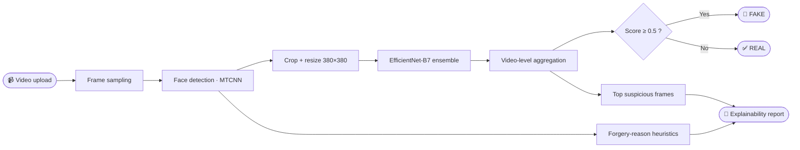
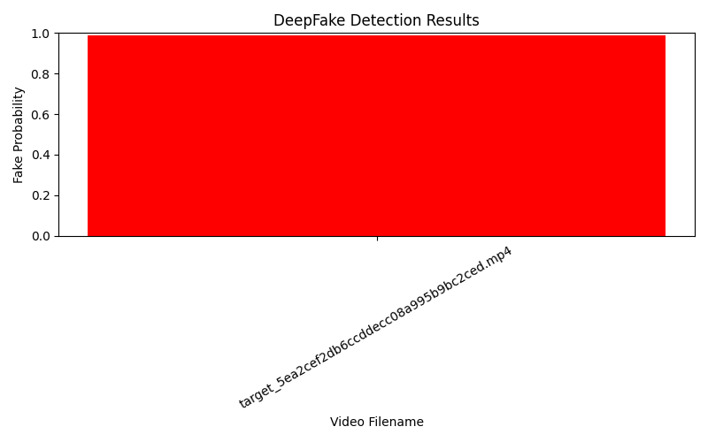

<!-- ═══════════════════════ HEADER ═══════════════════════ -->
<div align="center">


**Detect manipulated videos and *explain* the verdict — not just REAL / FAKE.**

<p>
  
  
  
  
  
  
  
  
</p>

<a href="#-quick-start">Quick Start</a> ·
<a href="#-how-it-works">How It Works</a> ·
<a href="#-project-structure">Structure</a> ·
<a href="#-training--evaluation">Training</a> ·
<a href="#-license--credits">Credits</a>

</div>

---

## 📖 Table of Contents

- [Overview](#-overview)
- [Features](#-features)
- [How It Works](#-how-it-works)
- [Project Structure](#-project-structure)
- [Tech Stack](#-tech-stack)
- [Quick Start](#-quick-start)
- [Usage](#-usage)
  - [Web API](#-web-api-flask)
  - [React UI](#-react-ui)
  - [Gradio Demo](#-gradio-demo-optional)
  - [Command-line Inference](#-command-line-inference)
- [Training & Evaluation](#-training--evaluation)
- [Configuration](#-configuration)
- [Environment Variables](#-environment-variables)
- [Tests](#-tests)
- [Results](#-results)
- [Roadmap](#-roadmap)
- [License & Credits](#-license--credits)

---

## 🔍 Overview

**DFdetect** is an end-to-end system that determines whether a video has been
manipulated (deepfake) using **deep learning + computer vision**, and returns an
**explainable** result: a verdict, a confidence score, the most suspicious
frames, and a human-readable list of *why* the model flagged it.

It is built as a research-friendly codebase — preprocessing, datasets, models,
training, explainability, calibration, evaluation and inference are cleanly
separated under `src/`, while the API, demo and web UI live under `app/`.

> **Pipeline in one line:** sample frames → detect faces (MTCNN) → crop to
> 380×380 → EfficientNet-B7 ensemble → aggregate to a video verdict → collect
> evidence frames + forgery reasons.

---

## ✨ Features

| | Feature | Description |
|---|---|---|
| 🎯 | **Accurate detection** | EfficientNet-B7 (NoisyStudent) classifier, optionally a 7-model ensemble |
| 🧠 | **Frame → video aggregation** | Confident-strategy pooling over face probabilities |
| 🔎 | **Explainable AI** | Forgery reasoning (boundary artifacts, texture, lighting, temporal jitter) + top suspicious frames |
| 🖼️ | **Grad-CAM** | Heatmap overlays highlighting what the model looked at |
| 📊 | **Calibration** | Temperature scaling, ECE, Brier score, reliability diagrams |
| 🌍 | **Cross-dataset eval** | Train on FF++ → test on Celeb-DF / DFDC |
| 🛡️ | **Robustness testing** | JPEG compression, blur and noise perturbation grids |
| 🧩 | **Swappable models** | Registry (`resnet_gap`, `srm`, `gwap`) — change backbones without touching training code |
| 🖥️ | **Full web stack** | Flask REST API + React/Vite UI + Gradio demo |
| ✅ | **Tested** | `pytest` suite for the detector and dataset |

---

## ⚙️ How It Works



1. **Frame sampling** — frames are sampled based on video duration/FPS.
2. **Face detection & cropping** — MTCNN finds faces; each is isotropically resized and center-padded to 380×380.
3. **Classification** — one or more EfficientNet-B7 heads produce per-face probabilities.
4. **Aggregation** — a confident strategy pools face scores into a single video probability.
5. **Explainability** — boundary/texture/lighting/temporal heuristics plus the highest-scoring frames explain the verdict.

---

## 📂 Project Structure

```
deepfake-detection/
├── configs/                   # YAML experiment configs (base merged underneath)
│   ├── base.yaml              # seed, paths, image size, batch size
│   ├── train_ffpp.yaml        # train on FaceForensics++
│   └── eval_crossdata.yaml    # test on Celeb-DF / DFDC
├── data/                      # gitignored contents (skeletons tracked)
│   ├── raw/                   # ffpp/, celebdf/, dfdc/, fakeavceleb/
│   ├── frames/                # sampled frames
│   ├── faces/                 # cropped faces
│   └── splits/                # train/val/test csv files
├── src/
│   ├── preprocessing/         # frame_sampler · face_detector · extract_faces · make_splits
│   ├── datasets/              # base · ffpp · celebdf · dfdc
│   ├── models/                # backbone · classifier · registry
│   ├── training/              # trainer · losses · augmentations · train
│   ├── explainability/        # gradcam · overlay
│   ├── calibration/           # temperature_scaling · metrics
│   ├── evaluation/            # evaluate · cross_dataset · robustness
│   ├── inference/             # predict_image · predict_video (shared with the web app)
│   ├── phase2/                # stretch: audio, lip-sync, multimodal fusion
│   └── utils/                 # config · seed · logging · io · plotting
├── app/
│   ├── server.py              # Flask REST API
│   ├── demo.py                # Gradio demo
│   └── frontend/              # React + Vite web UI
├── notebooks/                 # EDA & result plots
├── results/
│   ├── checkpoints/           # model checkpoints
│   ├── figures/               # gradcam samples, ROC, reliability plots
│   └── tables/                # metrics per experiment (csv/json)
├── tests/                     # test_face_detector · test_dataset
├── scripts/                   # run_preprocess · train · predict_submission · download_weights · run_all_experiments
├── docs/                      # report, IEEE paper, presentation
├── requirements.txt
├── environment.yml
└── README.md
```

---

## 🛠️ Tech Stack

<table>
<tr>
<td valign="top" width="33%">

**Machine Learning**
- Python 3.10
- PyTorch 2.5
- timm · EfficientNet-B7
- OpenCV · facenet-pytorch
- albumentations

</td>
<td valign="top" width="33%">

**Backend / Serving**
- Flask + Flask-CORS
- REST API (`/predict`)
- Gradio demo (optional)
- NumPy-aware JSON

</td>
<td valign="top" width="33%">

**Frontend**
- React 19 + Vite
- React Router
- Tailwind CSS

</td>
</tr>
<tr>
<td valign="top">

**Explainability**
- Grad-CAM
- Forgery-reason heuristics
- Frame evidence gallery

</td>
<td valign="top">

**Evaluation**
- scikit-learn metrics
- Calibration (ECE, Brier)
- Cross-dataset & robustness

</td>
<td valign="top">

**Tooling**
- pytest
- PyYAML configs
- bash scripts + Git

</td>
</tr>
</table>

---

## 🚀 Quick Start

> **Requires Python 3.10.** The pinned ML dependencies do not build on newer Python.
> `requirements.txt` pins `torch==2.5.1`, whose default PyPI wheel is the **CUDA**
> build (~3 GB). On a machine **without an NVIDIA GPU**, install the CPU-only
> wheel first so those libraries are skipped — `setup.sh` does this for you.

```bash
# 1. Clone
git clone <your-repo-url> DeepFake_Detection_System
cd DeepFake_Detection_System

# 2. One-shot setup: venv + CPU-only PyTorch + deps + pretrained weights
./setup.sh
source .venv/bin/activate

# 3. Run the backend
python -m app.server            # → http://localhost:5000
```

<details>
<summary><b>Manual setup (equivalent)</b></summary>

```bash
python3.10 -m venv .venv
source .venv/bin/activate
pip install torch==2.5.1 torchvision==0.20.1 torchaudio==2.5.1 \
    --index-url https://download.pytorch.org/whl/cpu     # CPU-only PyTorch
pip install -r requirements.txt
./scripts/download_weights.sh                            # → ./weights
python -m app.server
```
</details>

The model loader uses `weights/model_v1` by default. To run the full **7-model
ensemble**, download all weights and set `DFDETECT_WEIGHTS` to a comma-separated
list of checkpoint filenames (see `scripts/download_weights.sh`).

---

## 🖥️ Usage

### 🔌 Web API (Flask)

```bash
python -m app.server            # http://localhost:5000
```

| Method | Endpoint | Description |
|---|---|---|
| `GET` | `/health` | Health check |
| `POST` | `/predict` | Analyze a video · multipart field **`file`** |
| `POST` | `/upload-test` | Save an upload without analyzing it |

```bash
curl -X POST -F "file=@path/to/video.mp4" http://localhost:5000/predict
```

```jsonc
{
  "label": "REAL",                 // or "FAKE" / "NO_FACES"
  "confidence": 98.39,             // % confidence in the label
  "frames": ["<base64 jpeg>", "..."],   // top suspicious frames
  "frame_scores": [0.018, "..."],
  "forgery_reasons": {
    "reasons": [
      { "type": "boundary_artifact", "score": 0.51, "reason": "Visible blending/edge artifacts…", "evidence_frames": [7, 9, 11] }
    ],
    "mean_model_score": 0.02,
    "temporal_metrics": { "flow_variance": 0.11, "flow_mean": 0.03 }
  },
  "paths": { "annotated_frames_path": "uploads/…/frames", "video_path": "uploads/…/video/x.mp4" }
}
```

### ⚛️ React UI

```bash
cd app/frontend
npm install
npm run dev          # → http://localhost:5173
```

Vite proxies `/predict`, `/health` and `/upload-test` to the Flask backend on
`127.0.0.1:5000`, so run the backend first.

### 🎨 Gradio Demo (optional)

```bash
pip install gradio
python -m app.demo   # → http://localhost:7860
```

### ⌨️ Command-line Inference

```bash
# Single image (with optional Grad-CAM overlay)
python -m src.inference.predict_image --image face.jpg --weights weights/model_v1 --gradcam --out cam.jpg

# Batch videos → CSV
python -m src.inference.predict_video \
  --test-dir data/raw/test \
  --output results/tables/predictions.csv \
  --models final_111_DeepFakeClassifier_tf_efficientnet_b7_ns_0_36

# Or via the helper script (full 7-model ensemble)
./scripts/predict_submission.sh data/raw/test results/tables/predictions.csv
```

---

## 🧪 Training & Evaluation

```bash
# 1. Raw videos → faces → video-level splits
./scripts/run_preprocess.sh data/raw/ffpp data/faces/ffpp

# 2. Train on FaceForensics++
./scripts/train.sh configs/train_ffpp.yaml

# 3. Cross-dataset evaluation (Celeb-DF / DFDC)
python -m src.evaluation.cross_dataset \
  --checkpoint results/checkpoints/best.pt \
  --datasets celebdf dfdc \
  --out results/tables/cross_dataset.json

# 4. Robustness (compression / blur / noise)
python -m src.evaluation.robustness \
  --checkpoint results/checkpoints/best.pt \
  --dataset celebdf \
  --out results/tables/robustness.json

# …or everything end-to-end with one command
./scripts/run_all_experiments.sh
```

> **Note:** splits are always made **by video, not by frame** — otherwise
> near-identical frames leak across train/test and inflate metrics.

---

## 🗂️ Configuration

Training settings live in `configs/`; experiment configs are merged **on top of**
`configs/base.yaml`.

```yaml
# configs/base.yaml (excerpt)
seed: 42
data:
  image_size: 380
train:
  batch_size: 16
  epochs: 20
  loss: bce
  fake_weight: 1.4
model:
  name: resnet_gap            # resnet_gap | srm | gwap
  encoder: tf_efficientnet_b7_ns
```

---

## 🌱 Environment Variables

| Variable | Default | Purpose |
|---|---|---|
| `DFDETECT_WEIGHTS` | `model_v1` | Comma-separated checkpoint name(s) → ensemble |
| `DFDETECT_WEIGHTS_DIR` | `weights` | Directory containing checkpoints |
| `DFDETECT_DEVICE` | auto (`cuda` if available) | Force `cpu` / `cuda` |
| `DFDETECT_INPUT_SIZE` | `380` | Classifier input resolution |
| `DFDETECT_TOP_K` | `8` | Number of evidence frames returned |
| `DFDETECT_MIN_FRAMES` / `DFDETECT_MAX_FRAMES` | `16` / `64` | Frame sampling bounds |
| `DFDETECT_SPS` | `1.0` | Frames sampled per second |
| `DFDETECT_BATCH` | `8` (CPU) / `128` (GPU) | Inference batch size |
| `DFDETECT_UPLOADS` | `uploads` | Upload/output directory |
| `PORT` | `5000` | Flask port |
| `GRADIO_PORT` | `7860` | Gradio port |
| `DFDETECT_EAGER_LOAD` | `1` | Load model at server startup |

---

## ✅ Tests

```bash
pytest -q
```

```
10 passed
```

Covers the face detector/geometry helpers and the face-crop dataset.

---

## 📊 Results

<div align="center">
  
</div>

- Frame-level analysis with video-level aggregation
- Explainable verdict: confidence score + forgery reasons + evidence frames
- Cross-dataset and robustness reporting
- Interactive React UI with top-suspicious-frame gallery

> ⚠️ **Reproducibility note:** `weights/model_v1` is the **upstream public
> checkpoint** from `selimsef/dfdc_deepfake_challenge`, not a model trained in
> this repo. Reported accuracy may differ from a custom-trained model. Use
> `scripts/train.sh` to train your own.

---

## 🔮 Roadmap

- [x] Video deepfake detection (frame → video aggregation)
- [x] Forgery reasoning + evidence frames
- [x] Grad-CAM explainability
- [x] Calibration & cross-dataset evaluation
- [x] Web API + React UI + Gradio demo
- [ ] Audio / lip-sync detection and multimodal fusion (`src/phase2/`)
- [ ] URL-based video analysis
- [ ] Downloadable forensic PDF report
- [ ] GPU acceleration & cloud deployment

---

## 📜 License & Credits

This project is developed for **academic and research purposes**.

The EfficientNet-B7 deepfake classifier architecture and the pretrained weights
are derived from the public
[`selimsef/dfdc_deepfake_challenge`](https://github.com/selimsef/dfdc_deepfake_challenge)
release and remain under their original license — see [`LICENSE`](LICENSE).

<div align="center">
<br/>
<b>⭐ If you find this project useful, consider giving it a star! ⭐</b>
<br/><br/>
<sub>Built with PyTorch · OpenCV · Flask · React</sub>
</div>
